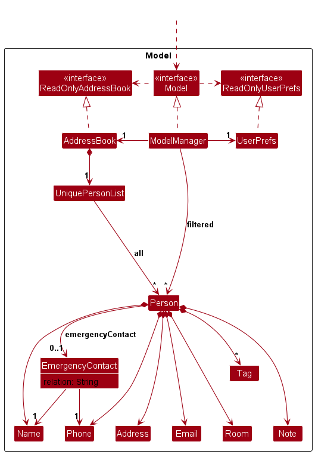
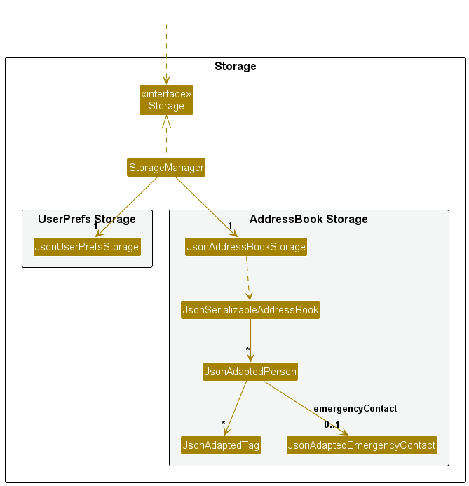

* Table of Contents
{:toc}

--------------------------------------------------------------------------------------------------------------------

## **Acknowledgements**

* _{List the sources of reused or adapted ideas, code, documentation, and third-party libraries here, with links to the originals.}_

--------------------------------------------------------------------------------------------------------------------

## **Setting up, getting started**

Refer to the guide [_Setting up and getting started_](SettingUp.md).

--------------------------------------------------------------------------------------------------------------------

## **Design**

<div markdown="span" class="alert alert-primary">

:bulb: **Tip:** The `.puml` files used to create diagrams are in `docs/diagrams`. Refer to the [_PlantUML Tutorial_ at se-edu/guides](https://se-education.org/guides/tutorials/plantUml.html) to learn how to create and edit diagrams.
</div>

### Architecture


The ***Architecture Diagram*** given above explains the high-level design of the App.

The following provides a quick overview of the main components and their interactions.

**Main components of the architecture**

**`Main`** (consisting of classes [`Main`](https://github.com/se-edu/addressbook-level3/tree/master/src/main/java/seedu/address/Main.java) and [`MainApp`](https://github.com/se-edu/addressbook-level3/tree/master/src/main/java/seedu/address/MainApp.java)) is in charge of the app launch and shut down.
* At app launch, it initializes the other components in the correct sequence, and connects them up with each other.
* At shut down, it shuts down the other components and invokes cleanup methods where necessary.

The bulk of the app's work is done by the following four components:

* [**`UI`**](#ui-component): The UI of the App.
* [**`Logic`**](#logic-component): The command executor.
* [**`Model`**](#model-component): Holds the data of the App in memory.
* [**`Storage`**](#storage-component): Reads data from, and writes data to, the hard disk.

[**`Commons`**](#common-classes) represents a collection of classes used by multiple other components.

**How the architecture components interact with each other**

The *Sequence Diagram* below shows how the components interact with each other for the scenario where the user issues the command `delete 1`.


Each of the four main components (also shown in the diagram above),

* defines its *API* in an `interface` with the same name as the Component.
* provides its functionality through a concrete `{Component Name}Manager` class that implements the corresponding API interface.

For example, the `Logic` component defines its API in `Logic.java` and implements it in `LogicManager.java`. Other components interact with a component through its interface rather than its concrete class, preventing them from coupling to that component's implementation, as illustrated in the following partial class diagram.


The sections below give more details of each component.

### UI component

The **API** of this component is specified in [`Ui.java`](https://github.com/se-edu/addressbook-level3/tree/master/src/main/java/seedu/address/ui/Ui.java)


The UI consists of a `MainWindow` and its parts, such as `CommandBox`, `ResultDisplay`, `PersonListPanel`, and `StatusBarFooter`. All of these, including `MainWindow`, inherit from the abstract `UiPart` class, which captures common behavior among classes that represent visible GUI parts.

The `UI` component uses the JavaFX UI framework. The layouts of these UI parts are defined in matching `.fxml` files in `src/main/resources/view`. For example, [`MainWindow.fxml`](https://github.com/se-edu/addressbook-level3/tree/master/src/main/resources/view/MainWindow.fxml) specifies the layout of [`MainWindow`](https://github.com/se-edu/addressbook-level3/tree/master/src/main/java/seedu/address/ui/MainWindow.java).

The `UI` component,

* executes user commands using the `Logic` component.
* listens for changes to `Model` data so that the UI can be updated with the modified data.
* keeps a reference to the `Logic` component, because the `UI` relies on the `Logic` to execute commands.
* depends on some classes in the `Model` component because it displays `Person` objects from the model.

### Logic component

**API** : [`Logic.java`](https://github.com/se-edu/addressbook-level3/tree/master/src/main/java/seedu/address/logic/Logic.java)

Here's a (partial) class diagram of the `Logic` component:


The sequence diagram below illustrates the interactions within the `Logic` component, taking `execute("delete 1")` API call as an example.


<div markdown="span" class="alert alert-info">:information_source: **Note:** The lifeline for `DeleteCommandParser` should end at the destroy marker (X), but due to a limitation of PlantUML, it continues to the end of the diagram.
</div>

How the `Logic` component works:

1. When `Logic` is called upon to execute a command, the command is passed to an `AddressBookParser` object, which in turn creates a parser that matches the command (e.g., `DeleteCommandParser`) and uses it to parse the command.
1. This results in a `Command` object (more precisely, an object of one of its subclasses e.g., `DeleteCommand`) which is executed by the `LogicManager`.
1. The command can communicate with the `Model` when it is executed (e.g. to delete a person).<br>
   Note that although this is shown as a single step in the diagram above for simplicity, the code can require several interactions between the command object and the `Model` to complete the operation.
1. The result of the command execution is encapsulated as a `CommandResult` object which is returned from `Logic`.

Here are the other classes in `Logic` (omitted from the class diagram above) that are used for parsing a user command:


How the parsing works:
* When called upon to parse a user command, the `AddressBookParser` class creates an `XYZCommandParser` (`XYZ` is a placeholder for the specific command name, e.g., `AddCommandParser`). The parser uses the other classes shown above to parse the user command and create an `XYZCommand` object (e.g., `AddCommand`). The `AddressBookParser` returns that object as a `Command` object.
* All `XYZCommandParser` classes, such as `AddCommandParser` and `DeleteCommandParser`, implement the `Parser` interface so they can be treated similarly where appropriate, for example during testing.

### Model component
**API** : [`Model.java`](https://github.com/se-edu/addressbook-level3/tree/master/src/main/java/seedu/address/model/Model.java)




The `Model` component,

* stores the address book data i.e., all `Person` objects (which are contained in a `UniquePersonList` object).
* stores the `Person` objects selected by the current filter, such as search results, in a separate _filtered_ list. It exposes this list as an unmodifiable `ObservableList<Person>` that the UI can observe and bind to, so the UI updates when the list changes.
* stores a `UserPrefs` object that represents the user’s preferences (currently, just the GUI settings). This is exposed to the outside as a `ReadOnlyUserPrefs` object.
* does not depend on any of the other three components (as the `Model` represents data entities of the domain, they should make sense on their own without depending on other components)

<div markdown="span" class="alert alert-info">:information_source: **Note:** The alternative, arguably more object-oriented, design below keeps a unique list of tags in `AddressBook`, and each `Person` references tags from that list. This lets `AddressBook` maintain one `Tag` object per unique tag instead of each `Person` holding its own `Tag` objects.<br>


</div>


### Storage component

**API** : [`Storage.java`](https://github.com/se-edu/addressbook-level3/tree/master/src/main/java/seedu/address/storage/Storage.java)



The `Storage` component,
* can save both address book data and user preference data in JSON format, and read them back into corresponding objects.
* is implemented by `StorageManager`, which delegates the actual JSON file access to `JsonAddressBookStorage` and `JsonUserPrefsStorage` (one class per data file).
* depends on some classes in the `Model` component (because the `Storage` component's job is to save/retrieve objects that belong to the `Model`)

### Common classes

Classes used by multiple components are in the `seedu.address.commons` package.

--------------------------------------------------------------------------------------------------------------------

## **Implementation**

This section describes some noteworthy details on how certain features are implemented.

### Tag feature

Tags are added to a contact when it is created, with `add NAME /phone PHONE [/room ROOM] [/tag TAG]...`.

#### Implementation

`AddCommandParser` uses `ArgumentTokenizer` with the `/phone`, `/room` and `/tag` keywords, so they can be given in any order. The text before the first keyword is the name. `/phone` must be given exactly once and `/room` at most once; a word starting with `/` that is not one of these keywords is rejected. `/tag` is optional and may be repeated, once per tag.

For each `/tag` value, `ParserUtil#parseTag()` collapses extra whitespace and reports the first problem it finds, in this order: empty, longer than `Tag.MAX_LENGTH`, invalid characters. So `/tag` with no value is reported as an empty tag, and `/tag RA, Staff` as invalid characters. `AddCommandParser` collects the tags into a `LinkedHashSet`, rejects a tag already given (`Contact already has this tag.`), and then rejects more than `Person.MAX_TAGS` tags.

`Tag` compares tag names ignoring case and stores them with the first letter of each word capitalized. `Person` keeps its tags in a `LinkedHashSet`, so they appear on the contact card in the order they were typed. `Person` also checks `Person.MAX_TAGS` in its constructor, and `JsonAdaptedPerson` rejects a data file that breaks this limit.

#### Design considerations

**Aspect: how tags are given**

* **Alternative 1 (current choice):** as part of `add`, with one `/tag` keyword per tag.
  * Pros: every command starts with a command word, and a new contact can be fully set up in one command.
  * Cons: tags cannot yet be added to an existing contact without replacing all of its tags with `edit`.
* **Alternative 2:** a separate command, typed as `CONTACT_NAME /tag TAG`, with no command word.
  * Pros: tags can be added to an existing contact.
  * Cons: it is the only command without a command word, so `AddressBookParser` needs a special case to recognize it, and it adds only one tag per command.

**Aspect: how several tags are separated**

* **Alternative 1 (current choice):** repeating the keyword, as in `/tag RA /tag Floor 3`.
  * Pros: it matches how AB3 repeats `t/`, and each tag's value is exactly what follows its keyword, so there is no separator to get wrong.
  * Cons: it takes more typing for each extra tag.
* **Alternative 2:** commas, as in `/tag RA, Floor 3`.
  * Pros: it is short to type, and commas cannot appear in a tag name.
  * Cons: stray commas (`/tag RA,,Staff`, `/tag RA,`) create empty tags that need their own error handling.

**Aspect: how a data file with more than 5 tags on a contact is handled**

* **Alternative 1 (current choice):** treat the file as invalid, as for any other invalid field.
  * Pros: it is consistent with the other fields, and every `Person` is guaranteed to have at most 5 tags.
  * Cons: one bad edit makes the app start with an empty address book.
* **Alternative 2:** load the extra tags and only enforce the limit when adding tags.
  * Pros: no data is lost.
  * Cons: the limit is no longer guaranteed, and contact cards can grow beyond 5 tags.

### Edit feature

`edit INDEX [/name NAME] [/phone PHONE] [/room ROOM] [/tag TAG]… [/note NOTE]` replaces only the fields that are given.

#### Implementation

`add` and `edit` share one definition of each field, so they cannot disagree about it. A `PersonField` holds a field's prefix, how its value is parsed and validated, how it is read from a `Person`, and the value `add` uses when the field is left out. `PersonField.values()` lists every field accepted by `add` and `edit`.

* `AddCommandParser` and `EditCommandParser` build their prefixes, duplicate checks and parsing from `PersonField.values()`. `add` reads the name from the text before the first prefix, and every other field with its prefix.
* `PersonFieldValues` stores a value per editable field. `EditPersonDescriptor` wraps one to hold the edited fields, and `EditCommand` copies the contact's current values, overwrites them with the edited ones and builds the new `Person`. It explicitly reapplies the original favourite status, which is not an editable field.
* `/tag` replaces all tags. Any optional field given with no value, such as `/tag` or `/room`, is reset to the value `add` uses when it is left out, which removes it. Required fields given with no value are rejected.

To add a new field supported by `add` and `edit`, add it to `Person`, add a constant to `PersonField` and list it in `PersonField.values()`, and add its `ParserUtil#parseXyz` method. `add` and `edit` then accept it without further changes. `PersonFieldTest` fails if such a field is not registered or has no sample value. Properties managed separately, such as `isFavourite`, are explicitly excluded in `NON_EDITABLE_PERSON_FIELDS` and must be preserved when editing.

### Note field

`/note NOTE` gives a contact a short free-text note, such as an allergy or how they prefer to be reached, so an RA on duty sees it on the contact card without looking elsewhere.

#### Implementation

`Note` is an immutable value class like `Room`, where an empty value means the contact has no note. It is added as the `PersonField.NOTE` field, so `add` and `edit` support `/note` through the mechanism above with no changes to either parser. `ParserUtil#parseNote` collapses whitespace and rejects an empty note, a note longer than 200 characters and a note containing `/`. `JsonAdaptedPerson` stores the note as an optional `note` property, so data files saved before this feature still load. `PersonCard` shows the note as a wrapped label that is hidden when the note is empty.

#### Design considerations

* **Alternative 1 (current choice):** a field set through `add` and `edit`.
  * Pros: one way to set every field, and `edit 1 /note` clears it like any other optional field.
  * Cons: a note is slightly longer to type than with a dedicated command.
* **Alternative 2:** a dedicated `note INDEX TEXT` command.
  * Pros: shorter to type.
  * Cons: a second way to change the same field, with its own parser and validation to keep in step with `edit`.

`/` is not allowed in a note because the parser treats a word starting with `/` as a field prefix. Allowing it only in the middle of a word would make the rule hard to explain to users.

### Emergency contact assignment

`emergency INDEX /name NAME /phone PHONE [/relation RELATION]` assigns one independent, immutable
`EmergencyContact` to a person in the displayed list. Name and phone are required; relation is optional.
Each assignment atomically replaces any existing emergency details; omitted relation defaults to empty.
Emergency details are independent of tags and of the general `list emerg` feature. Clearing is not supported yet.

`EmergencyCommandParser` and `EditCommandParser` share `ParserUtil#parseIndexedArguments()` for whitespace,
prefix and index handling. Emergency name and phone reuse `ParserUtil#parseName()` and `parsePhone()`.
Emergency details are kept outside the add/edit field registry. `PersonFieldValues#toPerson()` accepts them
separately so ordinary edits preserve them while constructing the replacement person once.
`Person#equals()` and `hashCode()` include the emergency details; `isSamePerson()` still compares names only.
`JsonAdaptedEmergencyContact` stores the nested details, and older files without this field remain valid.

### Filter by tag feature

`find /tag TAG` shows only contacts with the given tag. `FindCommandParser` creates a `PersonHasTagPredicate` from the value after `/tag`, and `FindCommand` applies it with `Model#updateFilteredPersonList()`. `PersonHasTagPredicate` uses `Tag#matchesName()`, so any non-empty value is accepted and a value that is not a valid tag simply matches nobody.

### Fuzzy name search

`find /name NAME` lists contacts whose name is close to `NAME`, so an RA on duty can find a resident despite a typo or
only half-remembering their name. Fuzzy matching applies only to `find /name`; `delete /name` still uses the exact,
case-sensitive `NameEqualsPredicate`, so a typo cannot delete a different contact.

#### Implementation

Given `find /name alx yeo`:

1. `FindCommandParser` creates a `NameFuzzyMatchesPredicate` from the value after `/name`.
2. The constructor collapses extra whitespace, converts the text to lowercase and splits it into the search words
   `alx` and `yeo`. Blank text is rejected, although the parser already prevents this.
3. `FindCommand` applies the predicate with `Model#updateFilteredPersonList()`.
4. For each contact, `NameFuzzyMatchesPredicate#test()` normalizes the name the same way and checks that **every**
   search word is close to **some** name word. Two words are close when their Levenshtein distance
   (`StringUtil#levenshteinDistance()`), the minimum number of single-character insertions, deletions or substitutions
   between them, is at most the number of typos allowed for the search word:

   | Search word length | Typos allowed |
   |--------------------|---------------|
   | 1–2                | 0             |
   | 3–5                | 1             |
   | 6–9                | 2             |
   | 10 or more         | 3             |

   The tiers are kept in the private `TypoTolerance` enum, which `NameFuzzyMatchesPredicate#getAllowedTypos()` reads.
5. `alx` is 1 typo from `alex` and `yeo` is 1 typo from `yeoh`, so `Alex Yeoh` is listed.

#### Design considerations

**Aspect: what is compared**

* **Alternative 1 (current choice):** each search word against each word of the name.
  * Pros: partial names (`find /name Yeoh`) and words in any order work, which suits an RA who remembers only part of
    a name.
  * Cons: a short surname such as `Tan` also matches similar names such as `Tay`.
* **Alternative 2:** the whole search text against the whole name.
  * Pros: fewer unexpected matches.
  * Cons: `find /name Alex` does not find `Alex Yeoh`, as the distance is too large.

**Aspect: how many typos are allowed**

* **Alternative 1 (current choice):** more typos for longer words.
  * Pros: long, hard-to-spell names tolerate several typos, while 1–2 letter words cannot match every contact.
  * Cons: the tiers are a judgement call that may need tuning from user feedback.
* **Alternative 2:** a fixed number of typos for every word.
  * Pros: simpler to explain.
  * Cons: short words match too many names, or long words tolerate too few typos.

**Aspect: where the distance is computed**

* **Alternative 1 (current choice):** our own `StringUtil#levenshteinDistance()`.
  * Pros: no new dependency, and it is short and fully unit-tested.
* **Alternative 2:** Apache Commons Text's `LevenshteinDistance`.
  * Cons: it adds a library for one method.

**Aspect: scalability**

Each search compares every search word with every word of every contact's name, so its cost grows linearly with the
number of contacts (and with the square of the word length). A hall has at most a few hundred residents plus staff,
vendors and emergency services, so a search takes milliseconds, which fits the expected needs of the target user.

If the number of contacts became very large (for example, tens of thousands or more), a different approach to fuzzy
search would have to be supported, such as:

* indexing the words of all names, for example in a BK-tree or a trigram index, kept up to date as contacts are
  added and deleted, so that only likely candidates are compared, and
* stopping each distance calculation early once it exceeds the number of typos allowed.

### Emergency contact listing

`list emerg` is a shortcut to display contacts with the whole tag `Emergency`, ignoring the tag's case.
The command words `list` and `emerg` must be lowercase. `AddressBookParser` routes `list` to
`ListCommandParser`, which returns `ListCommand` for blank arguments and `ListEmergencyCommand` for `emerg`.
`ListCommandParser` also accepts `fav` for favourite contacts. Unsupported arguments are rejected;
additional arguments after `emerg` use the emergency command's usage message.

`ListEmergencyCommand` applies `EmergencyContactPredicate` through `Model#updateFilteredPersonList()`.
It searches all stored contacts, preserves their order, and leaves stored data unchanged. The GUI reuses
the normal contact list. If there are no matches, the result message is `No emergency contacts found.`;
otherwise it is `Listed all emergency contacts.`. `find /tag Emergency` produces the same contact list
through the general tag search, while `list` restores all contacts.

### Favourite contacts

`fav INDEX` and `unfav INDEX` set an active contact's favourite status. `list fav` displays active favourite contacts
using the existing observable contact list.

#### Implementation

* **Model:** `Person` stores an immutable `isFavourite` boolean, defaulting to `false` in the existing constructors.
  `withFavourite(boolean)` returns a copy that preserves every other field, including notes, emergency details,
  archive status and tag order. All constructors delegate to one constructor accepting the complete contact state.
  Favourite status participates in `equals()` and `hashCode()`, but not `isSamePerson()`, so marking a contact
  does not change its identity or allow duplicates. `EditCommand` preserves the flag when rebuilding a contact.
* **Parsing:** `AddressBookParser` routes `fav` and `unfav` to `FavCommandParser` and `UnfavCommandParser`.
  Both reuse `ParserUtil#parseIndex()` and wrap parsing failures in the respective command's usage message.
  `ListCommandParser` returns `ListFavouriteCommand` for the exact `fav` argument and rejects extra arguments.
* **Commands:** `FavCommand` and `UnfavCommand` resolve the target from `Model#getFilteredPersonList()` before
  replacing it through `Model#setPerson()`. An out-of-range displayed index or an archived target raises a
  `CommandException`. Archived targets must be restored before changing favourite status, as with ordinary edits.
  Requests for an already-set status return explanatory feedback without replacing the contact.
  Neither command resets the current filter.
* **Listing:** `ListFavouriteCommand` combines `PREDICATE_SHOW_ACTIVE_PERSONS` with `Person::isFavourite` through
  `Model#updateFilteredPersonList()`. This replaces the previous filter and searches active contacts.
  Their relative stored order is retained,
  while displayed indices start at 1. Unfavouriting a displayed contact removes it from this view immediately.
* **Storage:** `JsonAdaptedPerson` reads and writes the JSON boolean `isFavourite`. Missing properties default to
  `false`, so older files remain readable. `LogicManager` saves changes through the existing storage path.
* **UI:** `PersonCard` shows the `favourite` label as `★ Favourite`, styled in `DarkTheme.css`.
  For other contacts, both `visible` and `managed` are false, so no badge space is reserved.
  Replacing a model entry refreshes its list cell with a new card and the updated status.

#### Design considerations

* A dedicated flag keeps favourite status independent of category tags and their replacement semantics.
  A tag named `favourite` has no special meaning.
* Separate set and unset commands make repeated submissions predictable: recalling `fav 1` cannot toggle
  the current contact off. As with other index commands, resubmission uses the list displayed at that time.
* Reusing the observable filtered list avoids a second collection of favourite contacts or a second index system.

#### Integration considerations

`withFavourite()`, `withArchive()` and `withEmergencyContact()` preserve each other's fields and notes.
`EditCommand` preserves favourite status and emergency details while rebuilding an active contact.
Archiving retains favourite status and hides the contact from `list fav`; restoration makes it visible again.
`fav` and `unfav` reject archived contacts even if they already have the requested status.
JSON storage preserves both status flags and emergency details. Missing status fields default independently
to `false`, allowing files from before either feature to load with their other details intact.

#### Testing

`PersonTest` and `EditCommandTest` cover default values, immutable copies, identity, and preservation during edits.
`FavouriteCommandsTest`, `FavouriteCommandParsersTest`, `ListFavouriteCommandTest` and the shared parser tests
cover indices, invalid arguments, repeated commands, filtering and result order. Storage tests and
`LogicManagerTest` check saving, reloading and compatibility with missing flags. `PersonCardTest` checks badge
visibility, emergency details and refreshes using real JavaFX controls. `FavouriteArchiveIntegrationTest`
checks archive/restore across restarts, preserved details, archived-command rejection and older data files.
See the [testing guide](Testing.md#favourite-contact-tests)
and the [manual checks](#managing-favourite-contacts).

### Command recall

Users browse submitted command text with Up/Down in the command box and press Enter to submit it again.
Recall does not restore contact data or implement the proposed undo/redo feature below.

#### Implementation

Each `CommandBox` owns a `CommandHistory` instance. `CommandHistory` stores the latest 100 non-blank
submissions in an `ArrayList`, from oldest to newest, preserving the submitted text and duplicates.
It holds no contact data and is not serialized, so a new app session starts with empty history.

* `add(commandText)` ignores blank input. Otherwise, it appends the text, evicts the oldest entry if needed,
  resets `historyPosition` to `commands.size()`, and clears the saved draft.
* `historyPosition == commands.size()` means the user is not browsing history. The first
  `navigatePrevious(currentInput)` saves `currentInput` as the draft, then moves towards older entries.
  At the oldest entry it returns that entry again; with empty history it returns the input unchanged.
* `navigateNext(currentInput)` moves towards newer entries. Passing the newest entry restores the saved
  draft. When not browsing, it returns the input unchanged.
* Editing recalled text does not update a stored entry or the draft. Only a new submission records it.
  `getCommands()` returns an unmodifiable snapshot for inspecting the history without changing it.

`CommandBox` installs a `KEY_PRESSED` filter on its text field, before JavaFX's normal key handling.
Unmodified Up/Down events call the corresponding navigation method, display the returned text, move the
caret to the end, and consume the event. Other keys and modified arrows retain their normal behavior.
Because the filter belongs to the command field, arrow events in other controls do not navigate history.

On Enter, `CommandBox` records non-blank input before calling `CommandExecutor#execute()`, so both parse
failures and execution failures remain recallable. Successful execution clears the field; failures retain
the submitted text and existing error styling. Navigation itself never calls the executor.

#### Design considerations

* **Session-only text history:** keeps recall independent of contact storage and avoids saving command
  parameters to a history file. Earlier sessions cannot be recalled.
* **A separate history helper:** lets storage, bounds, and draft handling be tested without JavaFX.
  The command box remains responsible for key events, display, submission, and error styling.
* **One saved draft:** preserves the unfinished input present before browsing. Edits to recalled entries
  are discarded when navigating rather than maintained as additional drafts.

#### Testing

`CommandHistoryTest` covers storage, the 100-entry limit, navigation boundaries, drafts, and resets.
`CommandBoxTest` uses real JavaFX controls and dispatched key events to cover their integration with
submission and error handling, including index-based commands using the current contact list.
See the [testing guide](Testing.md) for JavaFX display requirements and the
[manual checks](#recalling-previous-commands) for keyboard behavior in the running app.

### \[Proposed\] Undo/redo feature

#### Proposed Implementation

The proposed undo/redo mechanism is facilitated by `VersionedAddressBook`. It extends `AddressBook` with an undo/redo history, stored internally as an `addressBookStateList` and `currentStatePointer`. Additionally, it implements the following operations:

* `VersionedAddressBook#commit()` — Saves the current address book state in its history.
* `VersionedAddressBook#undo()` — Restores the previous address book state from its history.
* `VersionedAddressBook#redo()` — Restores a previously undone address book state from its history.

These operations are exposed in the `Model` interface as `Model#commitAddressBook()`, `Model#undoAddressBook()` and `Model#redoAddressBook()` respectively.

Given below is an example usage scenario and how the undo/redo mechanism behaves at each step.

Step 1. The user launches the application for the first time. The `VersionedAddressBook` will be initialized with the initial address book state, and the `currentStatePointer` pointing to that single address book state.


Step 2. The user executes `delete 5` command to delete the 5th person in the address book. The `delete` command calls `Model#commitAddressBook()`, causing the modified state of the address book after the `delete 5` command executes to be saved in the `addressBookStateList`, and the `currentStatePointer` is shifted to the newly inserted address book state.


Step 3. The user executes `add n/David …​` to add a new person. The `add` command also calls `Model#commitAddressBook()`, causing another modified address book state to be saved into the `addressBookStateList`.


<div markdown="span" class="alert alert-info">:information_source: **Note:** If a command fails its execution, it will not call `Model#commitAddressBook()`, so the address book state will not be saved into the `addressBookStateList`.

</div>

Step 4. The user now decides that adding the person was a mistake, and decides to undo that action by executing the `undo` command. The `undo` command will call `Model#undoAddressBook()`, which will shift the `currentStatePointer` once to the left, pointing it to the previous address book state, and restores the address book to that state.


<div markdown="span" class="alert alert-info">:information_source: **Note:** If the `currentStatePointer` is at index 0, pointing to the initial AddressBook state, then there are no previous AddressBook states to restore. The `undo` command uses `Model#canUndoAddressBook()` to check if this is the case. If so, it will return an error to the user rather
than attempting to perform the undo.

</div>

The following sequence diagram shows how an undo operation goes through the `Logic` component:


<div markdown="span" class="alert alert-info">:information_source: **Note:** The lifeline for `UndoCommand` should end at the destroy marker (X), but due to a limitation of PlantUML, it continues to the end of the diagram.

</div>

Similarly, how an undo operation goes through the `Model` component is shown below:


The `redo` command does the opposite — it calls `Model#redoAddressBook()`, which shifts the `currentStatePointer` once to the right, pointing to the previously undone state, and restores the address book to that state.

<div markdown="span" class="alert alert-info">:information_source: **Note:** If the `currentStatePointer` is at index `addressBookStateList.size() - 1`, pointing to the latest address book state, then there are no undone AddressBook states to restore. The `redo` command uses `Model#canRedoAddressBook()` to check if this is the case. If so, it will return an error to the user rather than attempting to perform the redo.

</div>

Step 5. The user then decides to execute the command `list`. Commands that do not modify the address book, such as `list`, will usually not call `Model#commitAddressBook()`, `Model#undoAddressBook()` or `Model#redoAddressBook()`. Thus, the `addressBookStateList` remains unchanged.


Step 6. The user executes `clear`, which calls `Model#commitAddressBook()`. Since the `currentStatePointer` is not pointing at the end of the `addressBookStateList`, all address book states after the `currentStatePointer` will be purged. Reason: It no longer makes sense to redo the `add n/David …​` command. This is the behavior that most modern desktop applications follow.


The following activity diagram summarizes what happens when a user executes a new command:


#### Design considerations:

**Aspect: How undo & redo execute:**

* **Alternative 1 (current choice):** Saves the entire address book.
  * Pros: Easy to implement.
  * Cons: May have performance issues in terms of memory usage.

* **Alternative 2:** Individual command knows how to undo/redo by
  itself.
  * Pros: Will use less memory (e.g. for `delete`, just save the person being deleted).
  * Cons: We must ensure that the implementation of each individual command is correct.

_{more aspects and alternatives to be added}_

### \[Proposed\] Data archiving

_{Explain here how the data archiving feature will be implemented}_


--------------------------------------------------------------------------------------------------------------------

## **Documentation, logging, testing, dev-ops**

* [Documentation guide](Documentation.md)
* [Testing guide](Testing.md)
* [Logging guide](Logging.md)
* [DevOps guide](DevOps.md)

--------------------------------------------------------------------------------------------------------------------

## **Appendix: Requirements**

### Product scope

**Target user profile**:

* is a residential assistant at NUS hostels who manages contacts for residents, hall staff, vendors, and emergency services
* handles incidents and welfare cases during duty shifts, where knowing who to contact next is critical and a resident's details need to be at hand immediately
* has a need to manage a significant number of contacts
* prefers desktop apps over other types of applications
* can type fast
* prefers typing to mouse interactions
* is reasonably comfortable using CLI apps

**Value proposition**: Residential assistants keep track of contacts for residents, hall staff, vendors, and emergency services, currently scattered across chats and documents. This app brings them together in one organised place, optimised for typing so the right person or resident's details can be retrieved in seconds during an emergency.


### User stories

Priorities: High (must have) - `* * *`, Medium (nice to have) - `* *`, Low (unlikely to have) - `*`

| Priority | As a …​ | I want to …​ | So that I…​ |
| -------- | ------- | ------------ | --------------- |
| `* * *` | new user | add a contact with a name and a phone number | can start building up my contact list |
| `* * *` | new user | close the app with a command | do not have to reach for the mouse to quit |
| `* * *` | user on duty | search for a contact by name | can find the person I need while the resident is still at my door |
| `* * *` | user on duty | see a contact's phone number in the search result itself | can read out the number without opening anything further |
| `* * *` | user with contacts of several kinds | tag a contact by role, such as resident, staff, vendor or emergency | can tell at a glance who each contact is |
| `* * *` | user with contacts of several kinds | list only the contacts carrying a given tag | can look through one type of contacts |
| `* * *` | user with contacts of several kinds | add more than one tag to a contact | can record someone who is both a resident and a fellow RA |
| `* * *` | user | record a room number against a resident | can look up where a resident lives |
| `* * *` | user | list all my contacts | can see everything I have stored |
| `* * *` | user | delete a contact | can only keep needed contacts |
| `* * *` | user searching for a contact | search by tag as well as by name | can find the right vendor when I cannot recall the company name |
| `* * *` | user handling an emergency | list every contact tagged as emergency | can reach the on-call number without remembering a name |
| `* *` | user exploring the app for the first time | see the app preloaded with sample contacts | can see how the app will look once it holds my own data |
| `* *` | user exploring the app for the first time | list every command the app supports | can find out what the app does without reading a manual |
| `* *` | user ready to start using the app for personal use | delete all the sample data in one command | can quickly clear out the sample data before entering my own |
| `* *` | new user | see a confirmation message showing the contact I just added | can check the app recorded what I typed |
| `* *` | new user | be told what is wrong when I type a command incorrectly | can correct myself instead of guessing |
| `* *` | user who has forgotten a command | view the usage format of one specific command | can type it correctly on the first try |
| `* *` | user searching for a contact | search using only part of a name | can find someone without typing their full name |
| `* *` | user searching for a contact | have my search ignore capitalisation | do not have to remember how the name was typed in |
| `* *` | user | record an email address against a contact | can reach them through a more formal channel if needed |
| `* *` | user whose contact details have changed | edit a single field of an existing contact | do not have to retype the whole entry to fix one thing |
| `* *` | user | be warned when I add a contact whose name is already in use | do not end up with duplicate entries for one person |
| `* *` | user searching for a contact | search by room number | can identify a resident when all I know is where the problem is |
| `* *` | user | undo my last command | can recover from a deletion or edit I did not intend |
| `* *` | user | record an emergency contact against a resident | do not have to look for their family's number elsewhere |
| `* *` | user handling an emergency | look up a resident's emergency contact in one command | can notify their family within seconds |
| `* *` | user with new residents | archive a contact | can keep an old entry out of my list and searches without losing it |
| `* *` | user with archived contacts | list my archived contacts | can still look someone up when a query about last year comes in |
| `* *` | user with archived contacts | restore an archived contact to my main list | can bring a resident back if they return to the block |
| `* *` | user | hide private contact details | can minimize the chance of someone else seeing them by accident |
| `*` | user | use a short form of a long command | can enter commands with fewer keystrokes |
| `*` | user | bring back my previous command with a keypress | can repeat or amend a lookup without typing it again |
| `*` | user | redo a command I have undone | can get back a change I undid by accident |
| `*` | user with a long contact list | sort my contact list by name | can find my way around a list too long to scan |
| `*` | user handling an emergency | mark a contact as a favourite | can keep the numbers I need most within easy reach |
| `*` | user handling an emergency | list my favourite contacts | can reach my most-used numbers first |
| `*` | user with new residents | archive every contact carrying a given tag at once | can clear out last year's residents quickly |

### Use cases

(For all use cases below, the **System** is `RAcontact` and the **Actor** is a residential assistant, unless specified otherwise.)

**Use case: Restore an archived contact**

**MSS**

1.  User requests to view archived contacts.
2.  RAcontact shows the archived contacts.
3.  User requests to restore a specific archived contact.
4.  RAcontact returns the contact to the main contact list and confirms the restoration.

    Use case ends.

**Extensions**

* 2a. There are no archived contacts.

    * 2a1. RAcontact shows an empty archive.

      Use case ends.

* 3a. The specified contact is not in the archive.

    * 3a1. RAcontact shows an error message.

      Use case resumes at step 3.

**Use case: Start using RAcontact with real contacts**

**MSS**

1.  User requests to remove all sample contacts.
2.  RAcontact removes the sample contacts and confirms the removal.
3.  User requests to add a real contact with a name and phone number.
4.  RAcontact adds the contact, shows its details, and confirms the addition.

    Use case ends.

**Extensions**

* 3a. The name or phone number is invalid.

    * 3a1. RAcontact shows an error message and does not add the contact.

      Use case resumes at step 3.

**Use case: Find a contact by name**

**MSS**

1.  User requests to find a contact by entering `find /name` followed by all or part of the contact's name.
2.  RAcontact lists the contacts whose name is close to the entered name, ignoring case and small typos, and shows the number of contacts listed.

    Use case ends.

**Extensions**

* 1a. The `/name` prefix is missing, the name is empty, or there is text before `/name`.

    * 1a1. RAcontact shows an invalid command format error with the usage of `find`.

      Use case resumes at step 1.

* 1b. The `/name` prefix is given more than once.

    * 1b1. RAcontact shows a message naming the repeated prefix.

      Use case resumes at step 1.

* 2a. No contact has a name close to the entered name.

    * 2a1. RAcontact shows the message `No contacts found` and an empty list.

      Use case ends.

**Use case: Find contacts by tag**

**MSS**

1.  User requests to find contacts by entering `find /tag` followed by a tag.
2.  RAcontact lists the contacts who have exactly that tag (case-insensitive) and shows the number of contacts listed.

    Use case ends.

**Extensions**

* 1a. The `/tag` prefix is missing, the tag is empty, there is text before `/tag`, the prefix is directly followed by text (such as `/tagfriends`), or `/name` is also given.

    * 1a1. RAcontact shows an invalid command format error with the usage of `find`.

      Use case resumes at step 1.

* 1b. The `/tag` prefix is given more than once.

    * 1b1. RAcontact shows a message naming the repeated prefix.

      Use case resumes at step 1.

* 2a. No contact has the entered tag.

    * 2a1. RAcontact shows the message `No contacts found` and an empty list.

      Use case ends.

**Use case: Find contacts during an emergency**

**MSS**

1.  User requests to find a resident by full name.
2.  RAcontact shows the resident's details.
3.  User requests to view the resident's emergency contact.
4.  RAcontact shows the emergency contact's details.
5.  User requests to view contacts tagged as emergency.
6.  RAcontact shows the emergency contacts, including the hall's on-call contact.

    Use case ends.

**Extensions**

* 2a. The resident cannot be found.

    * 2a1. RAcontact shows the message `No contacts found`.

      Use case resumes at step 1.

* 4a. No emergency contact is recorded for the resident.

    * 4a1. RAcontact informs the user.

      Use case resumes at step 5.

* 6a. No contacts are tagged as emergency.

    * 6a1. RAcontact shows an empty list.

      Use case ends.

### Non-Functional Requirements

1.  Should work on any _mainstream OS_ as long as it has Java `25` or above installed.
2.  Should be able to hold up to 1000 persons without noticeable sluggishness in performance for typical usage.
3.  A user with above average typing speed for regular English text (i.e. not code, not system admin commands) should be able to accomplish most of the tasks faster using commands than using the mouse.

*{More to be added}*

### Glossary

* **Mainstream OS**: Windows, Linux, Unix, or macOS
* **Private contact detail**: A contact detail that is not meant to be shared with others

--------------------------------------------------------------------------------------------------------------------

## **Appendix: Instructions for manual testing**

Given below are instructions to test the app manually.

<div markdown="span" class="alert alert-info">:information_source: **Note:** These instructions only provide a starting point for testers to work on;
testers are expected to do more *exploratory* testing.

</div>

### Launch and shutdown

1. Initial launch

   1. Download the JAR file and copy it into an empty folder.

   1. Double-click the JAR file.<br>
      Expected: The GUI opens with a set of sample contacts. The window size may not be optimal.

1. Saving window preferences

   1. Resize the window to an optimal size. Move the window to a different location. Close the window.

   1. Relaunch the app by double-clicking the JAR file.<br>
       Expected: The most recent window size and location are retained.

1. _{ more test cases …​ }_

### Deleting a person

1. Deleting a person while all persons are being shown

   1. Prerequisites: List all persons using the `list` command, with multiple persons in the list.

   1. Test case: `delete 1`<br>
      Expected: The first contact is deleted from the list. The status message shows the deleted contact's details.

   1. Test case: `delete 0`<br>
      Expected: No person is deleted. The status message shows error details.

   1. Other incorrect delete commands to try: `delete`, `delete x`, `...` (where x is larger than the list size)<br>
      Expected: Similar to previous.

1. _{ more test cases …​ }_

### Listing all contacts

1. Restoring a filtered list

   1. Prerequisites: Start with sample contacts and run `find /name Alex Yeoh`.

   1. Test case: `  list  `<br>
      Expected: All contacts appear in numbered order with their details. The message is `Listed all persons.`.

   1. Test case: Run `find /name Alex Yeoh`, then `list abc`.<br>
      Expected: `Invalid command format. Usage: list`.
      The filtered list and stored contacts stay unchanged.

1. Listing an empty address book

   1. Prerequisites: Use a disposable copy of the address book with no stored contacts.

   1. Test case: `list`<br>
      Expected: An empty list and `No contacts found.`.

### Adding a contact with tags

1. Adding a contact with tags

   1. Prerequisites: Start with the sample data.

   1. Test case: `add Sarah Tan /phone 9123 4567 /tag Resident Fellow /tag Floor 3`<br>
      Expected: Sarah Tan is added with the tags `Resident Fellow` and `Floor 3`, in that order.

   1. Test case: `add Daniel Lim /tag ra /room B-204 /tag  STAFF  /phone 8123 4567`<br>
      Expected: Daniel Lim is added with room `B-204` and the tags `Ra` and `STAFF`.

   1. Test case: `add Ben Ong /phone 9876 5432 /tag T1 /tag T2 /tag T3 /tag T4 /tag T5`<br>
      Expected: Ben Ong is added with 5 tags.

1. Adding a contact with invalid tags

   1. Test case: `add Ben Ong /phone 9876 5432 /tag T1 /tag T2 /tag T3 /tag T4 /tag T5 /tag T6`<br>
      Expected: No contact is added. Error: `Tag limit reached (max 5)`

   1. Test case: `add Ben Ong /phone 9876 5432 /tag RA /tag ra`<br>
      Expected: No contact is added. Error: `Contact already has this tag.`

   1. Test case: `add Ben Ong /phone 9876 5432 /tag RA /tag`<br>
      Expected: No contact is added. Error: `Tag cannot be empty.`

   1. Other incorrect commands to try: `add Ben Ong /phone 9876 5432 /tag RA, Staff`, `add Ben Ong /phone 9876 5432 /tag RA/Staff`, `add Ben Ong /phone 9876 5432 /tag` followed by 51 letters<br>
      Expected: No contact is added. The status message shows the matching error.

1. Typing the old tag command

   1. Test case: `Alex Yeoh /tag RA`<br>
      Expected: No change. Error: `Unknown command.`

### Filtering by tag

1. Prerequisites: Start with the sample data.

1. Test case: `find /tag friends`<br>
   Expected: Only contacts tagged `Friends` are shown. The status message shows how many are listed.

1. Test case: `find   /tag   FRIENDS  `<br>
   Expected: Same as above.

1. Test case: `find /tag Nobody`<br>
   Expected: An empty list. The status message shows `No contacts found`.

1. Test case: `find /tag`<br>
   Expected: The list is unchanged. Error: `Invalid command format!` followed by the `find` usage.

1. Other incorrect commands to try: `find friends`, `find /tag friends /name Alex`, `find /tag friends /tag family`<br>
   Expected: The list is unchanged. Error: `Invalid command format!` followed by the `find` usage.

1. Test case: `list /filter friends`<br>
   Expected: The list is unchanged. Error: `Invalid command format. Usage: list`

### Finding contacts by name

1. Prerequisites: Start with the sample data.

1. Test case: `find /name Alex Yeoh`<br>
   Expected: Only `Alex Yeoh` is shown. The status message shows `1 person(s) listed!`.

1. Test case: `find /name   alex   YEOH  `<br>
   Expected: Same as above; case and extra spaces are ignored.

1. Test case: `find /name alx yeo`<br>
   Expected: Same as above; each word has one typo.

1. Test case: `find /name Yeoh`<br>
   Expected: Same as above; part of the name is enough.

1. Test case: `find /name Charlote Oliviero`<br>
   Expected: Only `Charlotte Oliveiro` is shown; 8-letter words allow 2 typos.

1. Test case: `find /name Bolakrisnen`<br>
   Expected: Only `Roy Balakrishnan` is shown; a word of 10 or more letters allows 3 typos.

1. Test case: `find /name Li`<br>
   Expected: Only `David Li` is shown. `find /name Ly` shows an empty list and `No contacts found`, because
   2-letter words must be typed exactly.

1. Test case: `find /name Alex Tan`<br>
   Expected: An empty list. The status message shows `No contacts found`, because no word in any name is close to `Tan`.

1. Test case: `find /name`<br>
   Expected: The list is unchanged. Error: `Invalid command format!` followed by the `find` usage.

1. Test case: `find /name Alex /name Bernice`<br>
   Expected: The list is unchanged. An error names the repeated `/name` prefix.

1. Test case: `delete /name alex yeoh`<br>
   Expected: Nothing is deleted. The status message shows `No contacts found matching that search. No contacts deleted.`,
   because `delete /name` still needs the exact full name.

### Listing emergency contacts

1. Filtering all stored contacts

   1. Prerequisites: In a disposable address book, add at least one contact with `/tag emergency`,
      another with `/tag EMERGENCY`, and contacts with no tags or with `/tag emergencyservice`.

   1. Test case: `list emerg`<br>
      Expected: Only the contacts with a whole emergency tag appear, in stored order with their details.
      The message is `Listed all emergency contacts.`. Stored contacts are unchanged.

   1. Test case: Search for a non-emergency contact, then enter `  list   emerg  `.<br>
      Expected: The same emergency contacts appear, including contacts hidden by the search.

   1. Test case: `LIST emerg`, `List emerg`, or `LIST`<br>
      Expected: `Unknown command.`. The displayed list and stored contacts stay unchanged.

   1. Test case: `list EMERG` or `list EmErG`<br>
      Expected: `Invalid command format. Usage: list`.
      The displayed list and stored contacts stay unchanged.

   1. Test case: `list emerg friend`<br>
      Expected: `Invalid command format. Usage: list emerg`. The displayed list and stored contacts stay unchanged.

   1. Test case: `list`<br>
      Expected: All contacts appear again in numbered order.

1. Handling no matches

   1. Prerequisites: Use a disposable address book with no emergency tags, then repeat with no contacts.

   1. Test case: `list emerg`<br>
      Expected: An empty list and `No emergency contacts found.` in both cases.

### Adding, editing and removing notes

1. Adding a contact with a note

   1. Prerequisites: Start with the sample data.

   1. Test case: `add Wei Ming /phone 9876 5432 /note Allergic to peanuts,   carries an EpiPen`<br>
      Expected: Wei Ming is added. The contact card shows `Note: Allergic to peanuts, carries an EpiPen`
      below the phone number, with the extra spaces removed.

   1. Test case: `add Wei Ling /phone 9876 5433`<br>
      Expected: Wei Ling is added. The contact card shows no note line.

   1. Test case: `add Wei Ling /phone 9876 5433 /note`<br>
      Expected: No contact is added. Error: `Note cannot be empty.`

   1. Test case: `add Wei Ling /phone 9876 5433 /note call w/ parent`<br>
      Expected: No contact is added. Error: `Note cannot contain "/".`

   1. Test case: `add Wei Ling /phone 9876 5433 /note a /note b`<br>
      Expected: No contact is added. The error names `/note` as a repeated field.

   1. Test case: `add Wei Ling /phone 9876 5433 /note ` followed by 201 letters<br>
      Expected: No contact is added. Error: `Note too long, please shorten it and try again.`
      With exactly 200 letters, the contact is added and the note wraps onto several lines on the card.

1. Editing and removing a note

   1. Prerequisites: Start with the sample data. The 1st contact, Alex Yeoh, has a note.

   1. Test case: `edit 1 /note Prefers WhatsApp over calls`<br>
      Expected: The 1st contact's note is replaced. The status message ends with `Note: Prefers WhatsApp over calls`.

   1. Test case: `edit 1 /note`<br>
      Expected: The 1st contact's note is removed and the card no longer shows a note line.

   1. Test case: `edit 2 /room B-204`, then `edit 2 /room`<br>
      Expected: The 2nd contact's card shows `Room: B-204`, then the room line is removed.

   1. Test case: `edit 1 /note see /docs`<br>
      Expected: No contact is changed. The status message shows the `edit` usage, because `/docs` is not a known field.

   1. Test case: Close the app and reopen it.<br>
      Expected: Notes added or edited above are still shown.

### Managing favourite contacts

Use an empty, disposable address book for these checks. Add the following contacts in this order:

```text
add Favourite Test One /phone 91234567 /room B-204 /tag Resident /note Call after 6 pm
add Favourite Test Two /phone 91234568 /tag favourite
add Favourite Test Three /phone 91234569
```

Test | Commands or actions | Expected result
-----|---------------------|----------------
Initial status | `list` | All three contacts appear without a favourite badge, including Test Two with its `favourite` tag.
Marking | `fav 3`, then `fav 1` | Test Three and Test One gain the badge; their other details stay unchanged.
Listing and numbering | `list fav` | Test One is #1 and Test Three is #2, in stored order despite being marked in the reverse order. Message: `Listed all favourite contacts.`.
Repeated marking | `fav 1` | Message starts with `Contact is already a favourite:`. Data and the favourite view stay unchanged.
Removing from favourites | `unfav 2` | Test Three disappears from this view; Test One remains as #1. Test Three still exists in the address book.
Current displayed index | Repeat `unfav 2` | Error: `The person index provided is invalid.`. No contact is changed.
Ignoring previous filters | `find /phone 91234568`, then `list fav` | Test One is shown even though the previous search displayed only Test Two.
Replacing and clearing tags | `find /phone 91234567`, `edit 1 /tag Staff`, `find /phone 91234567`, `edit 1 /tag`, then `list fav` | Test One stays a favourite, with its room and note intact. Its tags are cleared. Search again before each edit because editing restores the full list.
Saving and restarting | Close and reopen the app, then `list fav` | Only Test One is a favourite. Its room, note and cleared tags remain as saved.
Repeated removal | `find /phone 91234567`, then `unfav 1` twice | The first command removes the badge. The second message starts with `Contact is not a favourite:`. Test One's other details remain intact.
No favourites | `list fav`, then `list` | The favourite view is empty with `No favourite contacts found.`. `list` restores all three contacts.
Invalid formats | `fav`, `fav 0`, `fav -1`, `fav 2147483648`, `unfav 1 extra` | Invalid command format and the respective usage message; data and the displayed list stay unchanged.
Out-of-range index | `fav 999999` | Error: `The person index provided is invalid.`; data and the displayed list stay unchanged.
Invalid listing | `list fav 1` | Error: `Invalid command format. Usage: list fav`; the displayed list stays unchanged.
Case sensitivity | `FAV 1`, `UNFAV 1`, `LIST fav`, `list FAV` | The first three report `Unknown command.`. The last reports `Invalid command format. Usage: list`. No data changes.

Repeat `list fav` in an empty disposable address book; it should show the same no-favourites message.

For backward compatibility, close the app and use a copy of a valid data file saved before this feature,
with no `isFavourite` properties. Reopen the app: every contact should be unfavourited, with its existing
details intact. Mark one contact, restart, and verify that the new status and existing details are retained.

For archive integration, run `find /phone 91234567`, then `fav 1` to mark Test One as a favourite.
Assign emergency details with `emergency 1 /name Jane Tan /phone 91234567 /relation Sister`.
Run `archive 1`, restart, and enter `list fav`: Test One is hidden. Run `list archived`, then try `fav 1`
and `unfav 1`: both must report that the contact needs to be unarchived, with no data changes.
Run `unarchive 1`, restart, and enter `list fav`: Test One is shown with its favourite badge, note and
emergency details preserved.

### Assigning and replacing a person's emergency contact

Use a disposable address book with just `Amy Bee`, created using
`add Amy Bee /phone 85355255 /note Call after 6pm`. Run `list` so Amy is displayed as contact 1.

| Test command or action | Expected result |
|---|---|
| `emergency 1 /name Bob Choo /phone 91234567 /relation Brother` | The card shows `emergency: Bob Choo(Brother) 91234567`; Amy's phone and note are unchanged. |
| `emergency 1 /name Alex Yeoh /phone 87654321` | The previous details are replaced by `emergency: Alex Yeoh 87654321`, with no relation. |
| `emergency 1 /name Bob Choo /phone abc` | Invalid-phone error; Alex's details remain unchanged. |
| `emergency 1 /name Bob Choo` | Usage error; existing details remain unchanged. |
| `emergency 2 /name Bob Choo /phone 91234567` | Invalid-index error; no contact is changed. |
| `emergency 1 /name Bob Choo /phone 91234567 /phone 87654321` | Duplicate-prefix error; existing details remain unchanged. |
| `edit 1 /note Changed note /room B-204 /tag` | Note and room change, tags are cleared, and Alex's emergency details remain. |
| `edit 1 /note` | The note is cleared; emergency details remain. |
| `list emerg`, then `list` | The general emergency list is empty; `list` restores Amy with her emergency details intact. |
| Close and reopen the app | Amy's replacement emergency details and room are still present. |

For filtered-list indexing, add a second person, use `find /name` to display only that person, and run
`emergency 1 /name Bob Choo /phone 91234567`. Only the displayed person receives the details.

### Saving data

1. Dealing with missing/corrupted data files

   1. _{Explain how to simulate missing or corrupted data files and state the expected behavior.}_

1. _{ more test cases …​ }_
