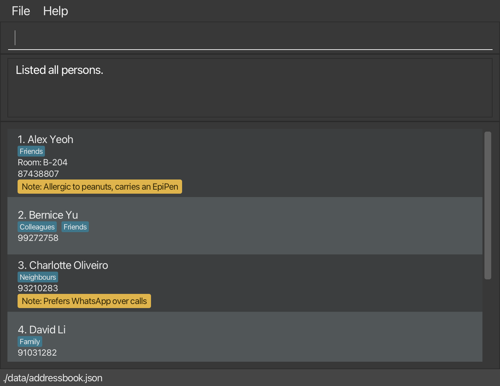

RAcontact is a **desktop contact management application for Residential Assistants (RAs) at NUS hostels**.
It brings contacts for residents, fellow RAs, hall staff, vendors and emergency services together in one place,
so you can find the right person or a resident's details during a duty shift without searching through chats and documents.

RAcontact is **optimized for fast typists through a Command Line Interface (CLI)**, with a Graphical User Interface (GUI)
for viewing contacts. You can search by name, phone, room or tag, keep favourites and record a resident's emergency contact.
The app stores and retrieves contact information; it does not make calls, send messages or manage duty rosters.

* Table of Contents
{:toc}

--------------------------------------------------------------------------------------------------------------------

## Quick start

1. Ensure that Java `25` or later is installed on your computer. 
   **Mac users:** Ensure you have the precise JDK version prescribed [here](https://se-education.org/guides/tutorials/javaInstallationMac.html).

1. Download the latest `.jar` file from [here](https://github.com/AY2627S1-CS2103T-F10-1/tp/releases).

1. Copy the file to the folder you want to use as the _home folder_ for your AddressBook.

1. Open a terminal, `cd` to the folder containing the JAR file, and run `java -jar addressbook.jar`. 
   A GUI similar to the one below should appear in a few seconds. Note how the app contains some sample data. 
   

1. Type a command in the command box and press Enter to execute it. For example, type **`help`** and press Enter to open the help window. 
   Some example commands you can try:

   * `list` : Lists all active contacts.

   * `list emerg` : Lists contacts tagged as emergency.

   * `fav 1` : Marks the 1st displayed contact as a favourite.

   * `list fav` : Lists favourite contacts.

   * `add John Doe /phone 98765432` : Adds a contact named `John Doe` to the Address Book.

   * `delete 3` : Deletes the 3rd contact shown in the current list.

   * `clear` : Deletes all contacts.

   * `exit` : Exits the app.

1. Use the Up (`↑`) and Down (`↓`) arrow keys in the command box to
   [recall previous commands](#recalling-previous-commands).

1. Refer to the [Features](#features) section below for details of each command.

--------------------------------------------------------------------------------------------------------------------

## Features

**:information_source: Notes about the command format:** 

* Words in `UPPER_CASE` are parameters to be supplied by the user. 
  For example, in `add NAME /phone PHONE`, replace `NAME` with `John Doe` and `PHONE` with `98765432`.

* Items in square brackets are optional. 
  For example, `add NAME /phone PHONE [/room ROOM]` can be used as `add John Doe /phone 98765432` or `add John Doe /phone 98765432 /room B-204`.

* Items followed by `…` can appear zero or more times. 
  For example, `[/tag TAG]…` may be omitted, or supplied as `/tag Friend` or `/tag Friend /tag Family`.

* For `add`, the name must come first. The prefixed fields after it can appear in any order. 
  For example, `add John Doe /phone 98765432 /room B-204` and `add John Doe /room B-204 /phone 98765432` are both accepted.

* Extraneous parameters for `help`, `exit`, and `clear` are ignored. The `list`, `list emerg`, `list archived`, `list fav`, `list sorted`,
  `fav INDEX` and `unfav INDEX` commands reject extra parameters. 
  For example, `help 123` is interpreted as `help`.

* If you are using a PDF version of this document, be careful when copying and pasting commands that span multiple lines as space characters surrounding line-breaks may be omitted when copied over to the application.

### Viewing help: `help`

Shows a message explaining how to access the help page.

Format: `help`

### Recalling previous commands

Reuse or correct previously submitted commands without typing them again.

Click the command box, then use these keys without holding Shift, Ctrl, Alt or Command:

Key | Action
----|-------
**↑ (Up)** | Recall the most recent command, then progressively older commands.
**↓ (Down)** | Browse newer commands. Moving past the newest entry restores the unfinished input typed before browsing.
**Enter** | Submit the text displayed in the command box.

* Recalling a command only fills the command box and moves the caret to the end.
  The contact list and result message do not change until you press Enter.
* The latest 100 non-blank submissions are remembered, including failed commands and repeated submissions.
  Empty or whitespace-only input is ignored. When the history is full, the oldest entry is discarded.
* Pressing ↑ at the oldest entry keeps showing that command. Pressing ↓ after restoring the unfinished
  input leaves that input unchanged. With no history, either arrow leaves the text unchanged.
* You can edit recalled commands. Navigating history discards unsubmitted changes to recalled text;
  it does not overwrite the original command or the unfinished input saved before browsing.
* Submitting a non-blank command adds a new history entry and discards the saved unfinished input.
  The next ↑ recalls that submission, even if it failed.
* History clears when you close the app; it is not saved with your contacts.
* This feature recalls text and does not undo or redo previous actions. Resubmitted commands use the
  current contact data and displayed indices: `delete 2` deletes whoever is currently shown as contact #2.

Example:

1. Submit `list`, then `find /tag Resident`.
1. Type `find /name Al` without pressing Enter.
1. Press ↑ to recall `find /tag Resident`, then ↑ again to recall `list`.
1. Press ↓ to return to `find /tag Resident`, then ↓ again to restore `find /name Al`.
1. Edit the text if needed and press Enter to execute it.

### Adding a contact: `add`

Adds a contact with a required name and phone number, and optional room, tags and note. Tags show a contact's category at a glance (e.g., `Resident`, `Resident Fellow`, `Staff`).

Format: `add NAME /phone PHONE [/room ROOM] [/tag TAG]…​ [/note NOTE]`

* Name is required and can contain up to 100 characters. Existing name character rules apply.
* Phone is required and can contain up to 20 characters: digits, spaces, `+`, hyphens and parentheses. It must contain at least one digit; formatting characters alone are rejected with `Phone number must contain at least one digit.`
* Room is optional for any contact, regardless of tags. It can contain up to 20 characters:
  letters, digits, spaces and hyphens.
* Note is optional free text, such as an allergy or how the contact prefers to be reached. It can contain
  up to 200 characters of any kind. `/` is allowed inside a word (e.g., `24/7`, `and/or`, `w/`, links), but a word
  cannot start with `/`, because that marks the start of a field. If a word in the note is a field name such as
  `/room` or `/tag`, the rest of the note is taken as that field: `/note talk to /room officer` gives the note
  `talk to` and the room `officer`.
* Enter the name first. `/phone`, `/room`, `/tag` and `/note` can then be given in any order.
  `/phone`, `/room` and `/note` cannot be repeated.
* Repeat `/tag` once per tag, up to five tags. Spaces inside a tag are allowed, so `/tag Resident Fellow` is one tag.
* Tags may contain letters and digits in any language (e.g., `Café`, `宿舍`), spaces and hyphens (`-`),
  up to 50 characters. They are not case-sensitive, and are displayed with the first letter of each word
  capitalized and the rest in lower case, so `RA`, `ra` and `Ra` all appear as `Ra`.
  Tags in an edited data file are displayed the same way.
  The 50-character limit applies to the tag as displayed; a few letters, such as the Turkish `İ`, take two
  characters in lower case.
* Duplicate tags, including tags differing only in case or extra spaces (e.g., `/tag RA /tag ra`), are rejected.
* Leading and trailing spaces are trimmed, and extra whitespace is collapsed into one space.
* Supplying `/room`, `/tag` or `/note` without a value is rejected.
* A contact is a duplicate when its name matches an existing contact (case-sensitive).
  The add command trims and collapses whitespace before comparing names. Phone number, room and tags do not
  affect duplicate detection.
* Contacts with the same name cannot be added, even when their phone numbers differ.
* On success, the contact appears in the list with its supplied room, tags and note, and
  `Contact NAME added successfully.` is shown. On failure, no contact is added.

Examples:

* `add Sarah Tan /phone 9123 4567`
* `add Daniel Lim /phone +65 8123 4567 /room B-204`
* `add Sarah Tan /phone 91234567 /room B-204 /tag Resident /tag Floor 3`
* `add Wei Ming /phone 9876 5432 /room C-310 /note Allergic to peanuts, carries an EpiPen`

### Listing active contacts: `list`

Shows all active (not archived) contacts in numbered order, including their available details.
This restores the active list after a search or archived view and does not change stored contacts.

Format: `list`

* Only the `archived`, `emerg`, `fav` and `sorted` subcommands are supported after `list`. To show only contacts with a given tag, use [`find /tag`](#locating-persons-by-name-tag-phone-or-room-find).

* The command keyword is case-sensitive: use lowercase `list`. `LIST` and `LiSt` are rejected as unknown commands.
* Leading and trailing spaces are ignored.
* Use `list emerg` for emergency-tagged contacts or `list fav` for favourite contacts, as described below.
  To search by any tag, use [`find /tag`](#locating-persons-by-name-tag-phone-or-room-find).
* Unsupported arguments, such as `list abc` or the retired `list /filter Emergency`, are rejected with
  `Invalid command format. Usage: list`. The displayed list stays unchanged when the command is rejected.
* When there are no active contacts, the list is empty and the result message is `No contacts found.`.
* Otherwise, the result message is `Listed all persons.`.

### Listing contacts sorted by name: `list sorted`

Shows all active contacts in ascending lexicographical order by their full names, including contacts hidden by
a previous search. Archived contacts are excluded.

Format: `list sorted`

* Names are sorted ignoring case, with case-sensitive ordering to break ties: `Amy Bee`, `amy Bee`, then `Zara Tan`.
* Sorting changes the displayed order only. Stored order and contact details stay unchanged.
* Index commands, such as `delete 1` and `archive 1`, act on the numbers in the sorted list.
* Commands that reset the view, including `list`, `find`, `add` and `edit`, restore stored order.
* Sorting is not saved between app sessions. Extra arguments and uppercase `SORTED` are rejected.
* Success: `Listed active contacts sorted by name.` If no active contacts exist: `No contacts found.`

### Listing emergency contacts: `list emerg`

Shows only active contacts carrying the complete tag `emergency`, in numbered order with their available details.
It searches all stored contacts, including those hidden by a previous search.
The command does not add, edit, delete, or deduplicate contacts.

Format: `list emerg`

* Both command keywords are case-sensitive: use lowercase `list emerg`.
  `LIST emerg`, `List emerg`, and `list EMERG` are rejected.
* Emergency tag matching is case-insensitive: tags such as `emergency`, `Emergency`, and `EMERGENCY` all match.
* Leading and trailing spaces, and extra spaces between the keywords, are ignored.
* A contact with several tags appears once if any tag is `emergency`.
  Tags such as `emerg` or `emergencyservice` do not match.
* Extra arguments, such as `list emerg friend`, are rejected with `Invalid command format. Usage: list emerg`.
  The displayed list stays unchanged when the command is rejected.
* When no emergency contacts exist, the list is empty and the message is `No emergency contacts found.`.
* Otherwise, the result message is `Listed all emergency contacts.`.
* `find /tag Emergency` displays the same contacts through the general tag search.
* Run `list` to return to all active contacts.

Example using the existing tag syntax:

1. `add Hall Security /phone 98765432 /tag Emergency`
1. `list emerg` shows Hall Security and any other emergency contacts.
1. `list` restores all active contacts.

### Marking a contact as a favourite: `fav`

Marks a frequently used contact for quick access. Favourite status is separate from tags:
adding a tag named `fav` or `favourite` does not mark a contact as a favourite.

Format: `fav INDEX`

* `INDEX` must be a positive integer identifying a contact in the currently displayed list.
  For example, after a search, `fav 1` marks the 1st search result.
* The contact card shows a **★ Favourite** badge. Its other details and the current filter are preserved.
* On success, the message starts with `Marked as favourite:` and includes the contact's details.
* Repeating the command leaves the contact unchanged and shows `Contact is already a favourite:`
  followed by its details. The command does not toggle the status.
* Ordinary edits and tag toggles preserve favourite status.
* Archived contacts must be unarchived before using `fav` or `unfav`. Otherwise, the command reports
  `Cannot change favourite status for an archived contact. Unarchive it first.` and leaves data unchanged.
* The command word is case-sensitive. Leading and trailing spaces are ignored; extra arguments are rejected.
* Missing, zero, negative, non-integer or overflowing indices show an invalid command format message with
  the `fav` usage. A positive index outside the displayed list shows `The person index provided is invalid.`.
  Rejected commands leave contact data and the displayed list unchanged.

Example: `fav 2` marks the 2nd currently displayed contact.

### Removing favourite status: `unfav`

Removes a contact's favourite status while retaining the contact and all its other details.

Format: `unfav INDEX`

* The index and argument rules are the same as for `fav`, using the currently displayed list.
* The badge disappears and the message starts with `Removed favourite status:` followed by the contact's details.
* If the contact is not a favourite, it stays unchanged and the message starts with `Contact is not a favourite:`.
* The current filter is preserved. In the `list fav` view, the contact disappears immediately and the
  remaining displayed contacts are renumbered. Check the displayed numbers before the next command.

Example: `unfav 1` removes favourite status from the 1st currently displayed contact.

### Listing favourite contacts: `list fav`

Shows active favourite contacts from across the address book, including those hidden by an earlier search.

Format: `list fav`

* Contacts keep their relative order from the main list, rather than the order in which they were marked.
  The displayed results are numbered consecutively from 1.
* For example, if the main list contains Alice at #1, Bob at #2 and Charlie at #3, marking Alice and Charlie
  shows Alice at #1 and Charlie at #2 in `list fav`. In that view, `unfav 2` removes Charlie's favourite status.
* Listing favourites does not change stored contact data.
* Archived contacts are hidden from this view but retain their favourite status. Restoring an archived
  favourite makes it appear here again. Run `list archived` and `unarchive INDEX` to restore it.
* Both words must be lowercase. Extra spaces or tabs between them are accepted.
* Extra arguments such as `list fav 1` are rejected with `Invalid command format. Usage: list fav`.
  The displayed list stays unchanged.
* With no favourites, the list is empty and the message is `No favourite contacts found.`.
  Otherwise, the message is `Listed all favourite contacts.`.
* Run `list` to show all active contacts again.

### Editing a person: `edit`

Changes one or more details of an active contact. Archived contacts must be unarchived before editing.

Format: `edit INDEX [/name NAME] [/phone PHONE] [/room ROOM] [/note NOTE]`

* `INDEX` is the number shown beside the contact in the current list, and must be a positive integer.
* At least one field must be given, in any order. Fields you leave out stay as they are.
* Each field follows the same rules as in `add`, so `/name`, `/phone`, `/room` and `/note` cannot be repeated.
* `edit` does not change tags, and `/tag` is rejected as an invalid command format. Use [`toggle`](#toggling-tags-toggle) to add or remove tags on an existing contact.
* The contact's tags and favourite status are preserved.
* On success, the full active contact list is shown again in stored order. Search again before using an index from the previous results.
* An optional field given with nothing after it is removed: `/room` on its own removes the room, and
  `/note` on its own removes the note. `/name` and `/phone` are required, so they cannot be removed.

Examples:
* `edit 2 /phone 9123 4567` changes the phone number of the 2nd contact.
* `edit 1 /room B-204 /note Prefers WhatsApp` sets the room and the note of the 1st contact.
* `edit 3 /room` removes the room of the 3rd contact.
* `edit 1 /note Prefers WhatsApp over calls` sets or replaces the note of the 1st contact.
* `edit 1 /note` removes the note of the 1st contact.

### Assigning an emergency contact: `emergency`

Stores or clears emergency details for a person without adding another entry to the contact list.

Format: `emergency INDEX /name NAME /phone PHONE [/relation RELATION]` or `emergency INDEX /clear`

* `INDEX` identifies the person in the currently displayed list, as with `edit`.
* Archived contacts must be unarchived before assigning, replacing or clearing emergency details. Otherwise, the command reports `Cannot change emergency details of an archived contact. Unarchive it first.` and leaves the contact and current view unchanged.
* When assigning or replacing details, name and phone are required and follow the same rules as `add`. Fields may appear in any order.
* Relation is optional free text, up to 50 characters. Extra whitespace is collapsed.
* Each prefix may appear only once. Invalid input leaves the contact unchanged.
* A person can have one emergency contact. Running the command again replaces all previous emergency details.
  Name and phone are required each time; omitting relation replaces the previous relation with an empty value.
* Emergency details are a separate person field. Toggling tags does not remove them.
* Use `/clear` alone after the index to remove the emergency details. It cannot be combined with `/name`, `/phone` or `/relation`, repeated, or followed by a value. If no emergency details are assigned, the command reports `No emergency contact assigned to NAME. No changes made.` and leaves the contact unchanged.
* Clearing preserves every other contact detail, including the general emergency tag, and keeps the current view.
* Details appear on the person's card and are saved automatically. Ordinary edits preserve them.
* The success message identifies the person and shows the new details as `emergency: NAME(RELATION) PHONE`; the relation and parentheses are omitted when no relation is given.
* The same emergency details may be assigned to several people independently.
* This does not change `list emerg`, which lists the app's tagged emergency resources.

Example: `emergency 1 /name Bob Choo /phone 9123 4567 /relation Brother`

To remove those details: `emergency 1 /clear`. The message is `Emergency contact cleared for NAME.`

### Toggling tags: `toggle`

Adds the tags a contact does not have, and removes the tags a contact already has.

Format: `toggle INDEX /tag TAG [/tag TAG]…​`

* `INDEX` is the number shown beside the contact in the current list, and must be a positive integer.
* At least one `/tag` must be given. Repeat `/tag` once per tag.
* Tags are matched the same way as in `add`, ignoring case and extra spaces.
* A tag cannot be repeated within one command.
* A contact can have at most 5 tags, including `emergency`. If the toggle would leave the contact with more, nothing is changed.
* Archived contacts must be unarchived before toggling their tags. Favourite status, emergency details and the note are not changed.
* On success, the full active contact list is shown again in stored order. Search again before using an index from the previous results.

Examples:
* `toggle 1 /tag emergency` marks the 1st contact as an emergency contact, or removes that if they already are one.
* `toggle 2 /tag Resident /tag Floor 3` toggles two tags of the 2nd contact at once.

### Locating persons by name, tag, phone or room: `find`

Finds active persons whose name is close to the given name, or who have the given tag, phone number or room.
Searches active contacts even when run from the archived view.

Format: `find /name NAME`, `find /tag TAG`, `find /phone NUMBER` or `find /room ROOM`

* Exactly one of `/name`, `/tag`, `/phone` and `/room` must be given, and nothing may be typed before it.
* Name search ignores capital letters and forgives small typos; for example, `find /name alx yeo` finds `Alex Yeoh`.
* Tag search ignores case and extra spaces; for example, `find /tag Friends` matches the tag `friends`.
* Spaces before and after `NAME`, `TAG`, `NUMBER` or `ROOM` are ignored.
* If no person matches, the message `No contacts found` is shown and the list is empty. Otherwise, the number of persons listed is shown.
* A prefix must be followed by a space, so `find /tagfriends` is not recognised as a tag search.
* If the prefix is missing or not followed by a space (such as `/tagfriends`), multiple search prefixes are given, or `NAME`, `TAG`, `NUMBER` or `ROOM` is empty, an invalid command format message is shown.
* If `/name`, `/tag`, `/phone` or `/room` is repeated, a message listing the repeated prefix is shown.

Finding by name (`/name`):
* You do not need the full name. Each word you type must match one of the words in the contact's name,
  in any order; for example, `find /name Yeoh` and `find /name Yeoh Alex` both find `Alex Yeoh`.
* Every word you type must match. For example, `find /name Alex Tan` does not find `Alex Yeoh`, because no part of
  the name is close to `Tan`.
* A word you type matches a word of the name if it is:
  * the same word, ignoring capital letters,
  * the start of the word, typed exactly and at least 3 letters long; for example, `find /name Bala` finds
    `Roy Balakrishnan`, or
  * the same word with a few typos. One typo is one wrong, missing or extra letter, or two neighboring letters
    swapped; for example, `Yoeh` is one typo away from `Yeoh`. The number of typos allowed depends on the
    **shorter** of the two words:

    | Letters in the shorter word | Typos allowed |
    |-----------------------------|---------------|
    | 1–2                         | 0             |
    | 3–5                         | 1             |
    | 6–9                         | 2             |
    | 10 or more                  | 3             |

    So `find /name Jonathn` (1 typo) finds `Jonathan Chua`, but `find /name Jnthn` (3 typos in a 5-letter word) does not.
    Short words must be typed exactly, so `find /name Al` does not find `Alex Yeoh`, and `find /name Ong` does not
    find `Ng Kai`.
* Because small typos are allowed, a search may also list contacts with similar names; for example,
  `find /name Tan` may also list a contact named `Tay`.
* The closest matches are listed first: contacts whose name contains the exact words you typed, then contacts
  whose name words start with what you typed, then contacts with typos, fewest typos first. Contacts that match
  equally well keep their usual order. For example, `find /name Tan` lists `Tan Wei Ming` before `Tay Li Hua`,
  so `edit 1` changes `Tan Wei Ming`.
* Extra spaces between words are ignored, including the non-breaking spaces that names pasted from a chat app
  or web page may contain.

Finding by phone (`/phone`):
* Searches all active contacts for an exact phone number, including contacts hidden by an earlier search.
* Extra spaces are ignored, as when storing phone numbers. Other formatting must match:
  `+65 9123 4567` does not match `+6591234567`, and `9123` does not match `91234567`.
* All contacts sharing the number are listed. Any non-empty value is accepted; an unknown value matches nobody.
* Example: `find /phone 91234567` lists contacts whose phone number is `91234567`.

Finding by tag (`/tag`):
* Only one tag can be searched at a time, so `find /tag friends /tag family` is rejected.
* Any non-empty `TAG` is accepted. A value that is not a valid tag, or that no contact has, simply matches nobody.
* A person is listed if any one of their tags is exactly `TAG`; for example, `find /tag friends` matches a person tagged `friends` and `owesMoney`, but not one tagged `friends2`.

Finding by room (`/room`):
* Matches the complete room number, ignoring case and extra whitespace: `find /room b-204` matches `B-204`.
* Partial numbers do not match. `B-204`, `B204` and `B 204` are different room numbers.
* Lists all active contacts sharing the room, including those hidden by a previous search.
* Contacts without a room and archived contacts are excluded. Any non-empty search value is accepted;
  an unknown room simply matches nobody.

Examples:
* `find /name Alex Yeoh` returns `Alex Yeoh`
* `find /name alex` returns `Alex Yeoh`
* `find /name Bernise` returns `Bernice Yu`, despite the typo
* `find /name Bala` returns `Roy Balakrishnan`
* `find /tag friends` returns all persons who have the tag `friends`
* `find /room B-204` returns all active persons whose room is `B-204`

### Archiving contacts: `archive`

Format: `archive INDEX` or `archive /tag TAG`

* `INDEX` is a positive integer from the currently displayed list, including search results.
* `/tag TAG` archives **all active contacts** with that tag across the address book,
  including contacts outside the displayed results. Matching ignores case and extra whitespace.
* Selection is internal: the command runs immediately without a preview or confirmation.
* The current view/filter stays in place. Archived contacts disappear from active results;
  in the archived view, newly archived contacts appear.
* The result reports how many contacts were archived. Already archived contacts are skipped
  for tag selection; selecting one by index reports that it is already archived.
* A missing tag, repeated `/tag`, mixed index/tag arguments, unknown prefix, or invalid index is rejected.
  An unmatched tag reports that no contacts were archived.
* Archiving preserves contact details. A same-name contact cannot be added while the original is archived;
  restore the existing contact instead.

Examples: `archive 1`, `archive /tag Study Group`.

### Listing archived contacts: `list archived`

Shows only archived contacts with their displayed index numbers. If none exist, the result is
`No archived contacts found.`. Extra arguments are rejected.

Use `list`, `find`, or `list emerg` to return to active contacts. Archived contacts remain
stored and are hidden at startup and in these normal lists/searches.

### Restoring archived contacts: `unarchive`

Format: `unarchive INDEX` or `unarchive /tag TAG`

* Run `list archived` before restoring by index. Use the index currently displayed.
* Tag selection restores all archived contacts matching the tag across the address book,
  ignoring case and extra whitespace. Active contacts are unchanged.
* The current view/filter stays in place: restored contacts disappear from the archived view.
  Use `list` to see them among active contacts.
* The result reports the number restored. An active contact selected by index or a tag with
  no archived matches produces an explanatory message without changing contacts.
* Argument validation follows the same rules as `archive`.

Example: `list archived`, then `unarchive 1`; or `unarchive /tag Study Group`.

### Deleting a person: `delete`

Permanently deletes the specified person from the address book. From `list archived`,
`delete INDEX` can delete an archived contact; it cannot then be unarchived.

Format: `delete INDEX` or `delete /name NAME`

* Deletes the person at the specified `INDEX`.
* The index refers to the index number shown in the displayed person list.
* The index **must be a positive integer** 1, 2, 3, …​
* Name deletion searches **all active contacts**, even when the displayed list is filtered.
* `/name NAME` must be the contact's exact full name, with matching capital letters. Unlike [`find /name`](#locating-persons-by-name-tag-phone-or-room-find), typos and partial names are not accepted, so a typo cannot delete a different contact.
* Leading and trailing whitespace is ignored, and extra whitespace between name words is collapsed, including Unicode spaces copied from other apps.
* If `/name` is missing or repeated, `NAME` is empty or there is text before `/name`, an invalid command format message is shown.
* Exactly one match is deleted immediately. With no matches, nothing is deleted.
* If more than one contact matches, nothing is deleted. The matching contacts are displayed with their indexes; continue with `delete INDEX`.
* The search results remain displayed; deleting the only match leaves an empty list. Use `list` to show all active contacts.
* Purely numeric input is treated as an index, so `delete 1` can never be a name search.

Examples:
* `list` followed by `delete 2` deletes the 2nd person in the address book.
* `find /name Betsy Crower` followed by `delete 1` deletes the 1st person in the results of the `find` command.

### Clearing all entries: `clear`

Permanently clears all active and archived entries, regardless of the current view.

Format: `clear`

### Exiting the program: `exit`

Exits the program.

Format: `exit`

### Saving the data

AddressBook automatically saves data after every command. You do not need to save manually. Archive state is stored as the boolean `archive`: `true`
means archived, and `false` means active. Older files without this field load contacts as active.

If saving fails, an error is shown and the in-memory change remains visible. It has not been
confirmed saved to disk; resolve the storage problem before relying on it surviving a restart.

Favourite status is saved with each contact and remains after restarting, including when the status is removed.
Older data files without favourite status still load; their contacts start unfavourited.

### Editing the data file

AddressBook data is saved automatically as a JSON file `[JAR file location]/data/addressbook.json`. Advanced users are welcome to update data directly by editing that data file.

Each contact's `isFavourite` property is a JSON boolean, `true` or `false`. If the property is absent, it defaults to `false`.

:exclamation: **Caution:**
If your changes make the data file invalid, AddressBook starts with an empty address book at the next run. The invalid file remains on disk until you run a command (AddressBook saves after every command). Still, we recommend backing up the file before editing it. 
A contact with more than 5 distinct tags also makes the data file invalid, as does a note longer than 200 characters or with a word starting with `/` (e.g., `see /docs`; a link such as `https://nus.edu.sg` is fine). See [`add`](#adding-a-contact-add) for the rules of each field. 
Furthermore, certain edits can cause the AddressBook to behave in unexpected ways (e.g., if a value entered is outside of the acceptable range). Therefore, edit the data file only if you are confident that you can update it correctly.

### Archiving data files `[coming in v2.0]`

_Details coming soon ..._

--------------------------------------------------------------------------------------------------------------------

## FAQ

**Q**: How do I transfer my data to another computer? 
**A**: Install the app on the other computer and overwrite the data file it creates with the data file from your previous AddressBook home folder.

--------------------------------------------------------------------------------------------------------------------

## Known issues

1. **When using multiple screens**, if you move the application to a secondary screen, and later switch to using only the primary screen, the GUI will open off-screen. The remedy is to delete the `preferences.json` file created by the application before running the application again.
2. **If you minimize the Help Window** and then run the `help` command (or use the `Help` menu, or the keyboard shortcut `F1`) again, the original Help Window will remain minimized, and no new Help Window will appear. The remedy is to manually restore the minimized Help Window.

--------------------------------------------------------------------------------------------------------------------

## Command summary

Action | Format, Examples
--------|------------------
**Add** | `add NAME /phone PHONE [/room ROOM] [/tag TAG]…​ [/note NOTE]`   e.g., `add Daniel Lim /phone 8123 4567 /room B-204 /tag Resident Fellow /tag Floor 3 /note Prefers WhatsApp`
**Archive** | `archive INDEX` or `archive /tag TAG`
**List archived** | `list archived`
**Unarchive** | `unarchive INDEX` or `unarchive /tag TAG`
**Clear** | `clear`
**Delete** | `delete INDEX` or `delete /name NAME`  e.g., `delete 3`, `delete /name Alice Tan`
**Edit (suspended)** | Temporarily unavailable. Displays `Edit not currently supported`.
**Find** | `find /name NAME`, `find /tag TAG`, `find /phone NUMBER` or `find /room ROOM`  e.g., `find /name alx yeo`, `find /tag friends`, `find /phone 87438807`, `find /room B-204`
**Edit** | `edit INDEX [/name NAME] [/phone PHONE] [/room ROOM] [/note NOTE]`  e.g., `edit 2 /phone 9123 4567`, `edit 3 /room`
**Toggle** | `toggle INDEX /tag TAG [/tag TAG]…​`  e.g., `toggle 1 /tag emergency`
**Find** | `find /name NAME`, `find /tag TAG` or `find /phone NUMBER`  e.g., `find /name James Jake`, `find /tag friends`
**List** | `list`
**List sorted by name** | `list sorted`
**List emergency contacts** | `list emerg`
**Mark favourite** | `fav INDEX`  e.g., `fav 2`
**Remove favourite status** | `unfav INDEX`  e.g., `unfav 1`
**List favourite contacts** | `list fav`
**Assign or clear emergency contact** | `emergency INDEX /name NAME /phone PHONE [/relation RELATION]` or `emergency INDEX /clear`
**Help** | `help`
**Recall commands** | ↑ for older commands; ↓ for newer commands or the saved unfinished input. Press Enter to execute. The command box must be focused.
